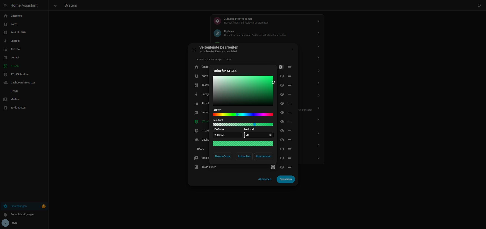
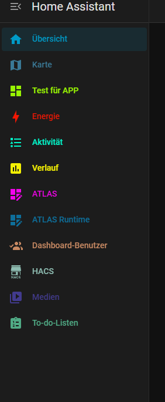
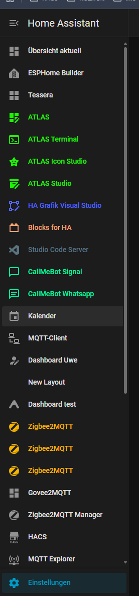

# Sidebar Colors


**0.1.1 · Home Assistant ≥ 2026.10.3 · DE / EN / FR · MIT**

Give each Home Assistant sidebar entry its own icon and text color, including opacity. A color field is added directly to **Edit sidebar**, next to the existing visibility and reorder controls. No Home Assistant core files are replaced.

[Deutsch](docs/README.de.md) · [Français](docs/README.fr.md) · [Full documentation](https://opensource.ugso-software.de/en/projects/sidebar-colors/) · [Downloads](https://github.com/rockbaer2007/ha-sidebar-colors/releases/latest)

## HA 2026.11 compatibility — 0.1.1

Supports both the legacy `ha-md-list-item` and HA 2026.11's `ha-list-item-button` when coloring native editor rows. Existing colors, opacity and storage keys are preserved; no migration is required. Minimum HA remains 2026.10.3.

The standalone bundle passes local DOM regression tests for both HA row types, including opacity, Cancel, Save, reopening and theme reset. The related Manager was live-tested on .177; Colors was not loaded alongside it. 27 automated tests pass. Update only the package you use; do not load Colors and Manager together.

## Install with HACS / Marketplace

This is a **frontend plugin**, not a Supervisor app or a Lovelace card to add to a dashboard. It is initially available as a custom repository; publication does not mean inclusion in the default catalog.

1. Back up your HA configuration and settings.
2. In **HACS → Custom repositories**, add `https://github.com/rockbaer2007/ha-sidebar-colors`, category **Dashboard** (`plugin` internally), then download **Sidebar Colors**.
3. Under the **existing** `frontend:` section in `configuration.yaml`, add the module below. Keep existing themes and module entries. Do not create a second `frontend:` block.

```yaml
frontend:
  # Preserve existing themes and extra modules.
  extra_module_url:
    - /hacsfiles/ha-sidebar-colors/ha-sidebar-colors.js
```

4. Check the HA configuration, restart HA and reload the browser. Adding only a dashboard resource is insufficient when you open a non-dashboard page first; `extra_module_url` loads the extension throughout the frontend.
5. Hold the **Home Assistant** sidebar heading to open **Edit sidebar**. Click a color field.

Starting with HA **2026.11**, HACS becomes the built-in **Marketplace**. The same `hacs.json`, plugin category and bundle are used. Existing HACS settings are carried over; no separate Sidebar Colors settings migration is required. The Marketplace route is **Settings → Marketplace**; use its custom-repository flow if the repository is not in the catalog. [Official Marketplace documentation](https://contributors.home-assistant.io/marketplace/how-it-works/)

[Open this repository in HACS](https://my.home-assistant.io/redirect/hacs_repository/?owner=rockbaer2007&repository=ha-sidebar-colors&category=plugin)

## Manual installation

Download `ha-sidebar-colors.js` from [Releases](https://github.com/rockbaer2007/ha-sidebar-colors/releases/latest), copy it to `/config/www/ha-sidebar-colors.js`, and use `/local/ha-sidebar-colors.js` in `extra_module_url` instead. The downloadable ZIP contains the same self-contained file, license and documentation. Do not load both installation paths.

If you used the earlier local three-file prototype, replace its `/local/ugso-sidebar-colors/0.1.0/sidebar-colors.js` module entry with the chosen new path, restart HA and reload the browser. Keep your existing user data: the storage key is unchanged. Old files may remain as a backup.

## Use

- Choose hue, saturation/brightness, HEX color and opacity, with a live preview.
- **Apply** closes the picker. Only the native sidebar **Save** persists the changes.
- **Cancel** in the picker restores its opening value. **Cancel** in the sidebar editor discards the color draft.
- **Theme color** removes the override for that entry. The checkerboard represents transparency; 0% opacity makes the icon and label invisible, but the color field stays available.
- Native eye buttons, keyboard reordering and drag handles retain their function. Selection background, titles and access permissions are unchanged.

## Screenshots

Color picker inside the native sidebar editor:



User-provided examples of individually colored icons and labels:





## Settings and updates

Colors are stored per HA user in the separate frontend key `ugso_sidebar_colors_v1`. Other tabs/devices for that user subscribe to changes when the extension is loaded. A colors-only save does not rewrite native sidebar order, hidden entries or theme settings. Entries are identified by panel path, not their displayed name.

Before saving colors, the extension keeps one previous snapshot of its colors and sidebar preferences in browser storage under `ugso-sidebar-colors-backup:<user-id>`. This is a local fallback, not a full HA backup. Blocked/full browser storage prevents saving. No additional token, external script or translation service is required.

Update the same repository in HACS/Marketplace, retain the module path and reload the browser. Settings stay in HA, not in the downloaded JavaScript directory. Back up before updates. To uninstall, remove the module entry, restart HA and reload; theme colors return without deleting native sidebar preferences.

## Tested scope and limitations

Live tests passed on **HA Core 2026.10.4**: picker, opacity (including zero), live preview, Save/Cancel, reload persistence, reset, two-tab synchronization and native visibility/reorder controls. Intended minimum **2026.10.3** is based on its frontend/storage interfaces, not a separate live test. Marketplace **2026.11** packaging follows its documented HACS-compatible format; no 2026.11 runtime test is claimed.

This extension hooks internal HA frontend dialog methods. Recheck it after HA frontend updates. Conflicts and uncertain saves keep the draft open; writes are not blindly retried. Exact simultaneous cross-device writes cannot be made atomic by this HA API. Mixed order/color saves are separate operations with best-effort compensation. See [testing notes](docs/TESTING.md).

## Development

```sh
npm ci
npm run check
npm test
npm run build
```

`dist/ha-sidebar-colors.js` is the deterministic, self-contained HACS/Marketplace artifact. GitHub Actions runs unit tests, HACS validation and tagged release packaging. Tagged releases must match `package.json`.

## References and license

- [HACS plugin packaging](https://www.hacs.dev/docs/publish/plugin/)
- [Marketplace manifest reference](https://contributors.home-assistant.io/marketplace/reference/hacs-json/)
- [HA sidebar dialog](https://github.com/home-assistant/frontend/blob/20260930.5/src/dialogs/sidebar/dialog-edit-sidebar.ts)
- [HA per-user frontend storage](https://github.com/home-assistant/core/blob/2026.10.3/homeassistant/components/frontend/storage.py)

Original UGSo Software implementation under the [MIT license](LICENSE). Community extension; not an official Home Assistant product. Screenshot publication authorized by the user.
