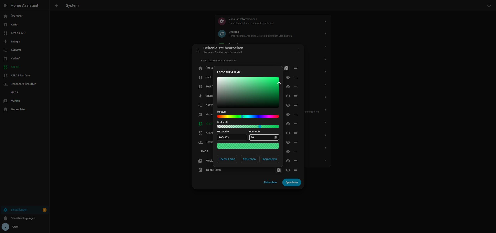
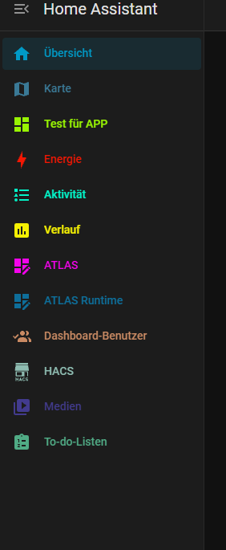
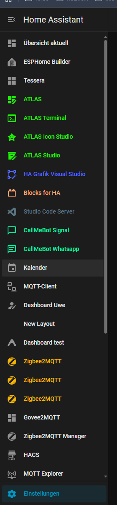

# Seitenleistenfarben / Sidebar Colors

**0.1.0 · Home Assistant ab 2026.10.3 · DE / EN / FR · MIT**

Eigene Farbe und Transparenz je Symbol und Beschriftung direkt in **„Seitenleiste bearbeiten“**. Farbfeld anklicken, Farbe wählen und über den vorhandenen HA-Dialog speichern. Auge und Verschiebegriff bleiben erhalten. Keine HA-Core-Dateien werden ersetzt.

## HACS / Marketplace installieren

Zuerst HA-Konfiguration und Einstellungen sichern. In **HACS → Benutzerdefinierte Repositories** `https://github.com/rockbaer2007/ha-sidebar-colors` als **Dashboard** hinzufügen und **Sidebar Colors** herunterladen. Es ist eine Frontend-Erweiterung, keine Supervisor-App und keine Karte zum Einfügen. Die Veröffentlichung ist noch keine Aufnahme in den Standardkatalog.

Im vorhandenen `frontend:`-Abschnitt ergänzen, bestehende Themes und weitere Module erhalten:

```yaml
frontend:
  # Vorhandene Themes und Module beibehalten.
  extra_module_url:
    - /hacsfiles/ha-sidebar-colors/ha-sidebar-colors.js
```

Keinen zweiten `frontend:`-Block anlegen. Konfiguration prüfen, HA neu starten und Browser neu laden. Eine Dashboard-Ressource allein genügt nicht für den Start auf anderen HA-Seiten.

Ab **2026.11** ist HACS als **Marketplace** unter Einstellungen integriert. Das gleiche `hacs.json` und Pluginformat gelten weiterhin; vorhandene HACS-Einstellungen werden übernommen. Keine gesonderte Migration der Seitenleistenfarben erforderlich. Das Repo kann zunächst als benutzerdefiniertes Repository hinzugefügt werden. [Offizielle Beschreibung](https://contributors.home-assistant.io/marketplace/how-it-works/)

## Manuell installieren oder vom lokalen Prototyp umsteigen

Die einzelne Datei `ha-sidebar-colors.js` aus den [Releases](https://github.com/rockbaer2007/ha-sidebar-colors/releases/latest) nach `/config/www/ha-sidebar-colors.js` kopieren und stattdessen `/local/ha-sidebar-colors.js` als Modul eintragen. Das ZIP enthält dieselbe Datei und Dokumentation. Nicht beide Wege gleichzeitig laden.

Beim früheren Drei-Dateien-Prototyp den alten Eintrag `/local/ugso-sidebar-colors/0.1.0/sidebar-colors.js` durch den neuen Pfad ersetzen. Einstellungen und Speicher bleiben erhalten; alte Dateien dürfen als Sicherung liegen bleiben.

## Bedienung

Den Kopf **Home Assistant** in der Seitenleiste länger gedrückt halten. Das Farbfeld zwischen Name und Auge öffnet HSV-Farbfläche, Farbton, HEX und Deckkraft mit Live-Vorschau. „Übernehmen“ schließt den Wähler; erst „Speichern“ im HA-Dialog sichert dauerhaft. „Abbrechen“ verwirft den jeweiligen Entwurf. „Theme-Farbe“ entfernt die eigene Farbe. Das Schachbrett zeigt Transparenz; bei 0 % Deckkraft sind Symbol und Text unsichtbar, das Farbfeld bleibt erreichbar.

Augen, Verschiebegriffe und Tastatursortierung funktionieren weiter. Auswahlhintergrund, Titel und Zugriffsrechte bleiben erhalten.

## Bilder







## Daten erhalten

Farben liegen pro HA-Benutzer unter `ugso_sidebar_colors_v1` und synchronisieren sich auf Geräten mit geladener Erweiterung. Nur Farben zu speichern überschreibt weder Reihenfolge noch ausgeblendete Einträge oder Theme. Die Zuordnung verwendet Panel-Pfade statt Namen.

Vor dem Farbspeichern wird ein vorheriger Farb-/Sidebar-Stand lokal im Browser unter `ugso-sidebar-colors-backup:<user-id>` gesichert. Das ersetzt kein HA-Backup. Blockierter oder voller Browserspeicher sperrt Speichern. Keine zusätzlichen Schlüssel, Cloud-Dienste oder externen Skripte.

Updates über dasselbe HACS-/Marketplace-Repo, Modulpfad beibehalten und Browser neu laden. Vorher sichern. Zum Rückbau den eigenen Moduleintrag entfernen, HA neu starten und Browser neu laden. Die Theme-Farben kehren zurück; native Einstellungen bleiben erhalten.

## Prüfstand und Grenzen

Echt geprüft auf **2026.10.4**: Farben, Alpha, Speichern/Abbrechen, Neuladen, Theme-Rücksetzen, Zweittab-Synchronisierung und native Augen-/Sortierfunktionen. **2026.10.3** ist die anhand der Schnittstellen vorgesehene Mindestversion, kein zusätzlicher Live-Test. Marketplace **2026.11** wird im dokumentierten Format vorbereitet, nicht als dort bereits laufzeitgeprüft bezeichnet.

Interne Frontend-Dialogmethoden können sich bei HA-Updates ändern. Konflikte und unklare Bestätigungen halten den Entwurf offen; kein blindes Wiederholen. Gleichzeitige Geräteschreibzugriffe sind nicht atomar. Gemischte Farb-/Reihenfolgeänderungen sind getrennte Vorgänge mit geprüftem bestmöglichem Rücksetzen. [Prüfdetails](TESTING.md).

[Quellcode](https://github.com/rockbaer2007/ha-sidebar-colors) · [Ausführliche Doku](https://opensource.ugso-software.de/projects/sidebar-colors/) · [MIT](../LICENSE)
