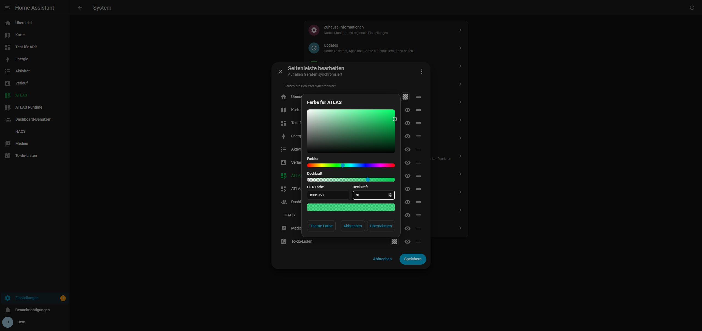
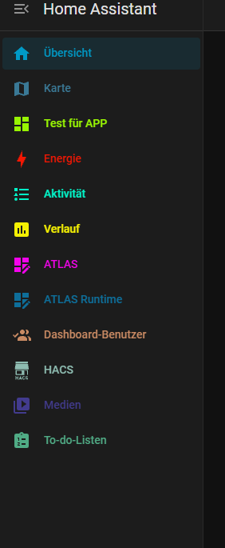
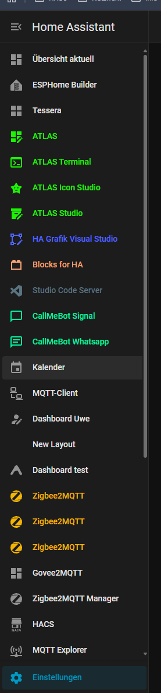

# Couleurs du menu latéral / Sidebar Colors

**0.1.1 · Home Assistant à partir de 2026.10.3 · DE / EN / FR · MIT**

Une couleur et une opacité propres à chaque icône et libellé, directement dans **Modifier la barre latérale**. Cliquer sur le carré de couleur, choisir la couleur puis enregistrer dans la fenêtre HA existante. L’œil et la poignée de tri restent disponibles. Aucun fichier du cœur HA n’est remplacé.

## Compatibilité HA 2026.11 — 0.1.1

Les couleurs des lignes de l’éditeur natif prennent en charge `ha-md-list-item` et le nouveau `ha-list-item-button`. Couleurs, opacité et clés de stockage existantes conservées ; aucune migration nécessaire. Version minimale : HA 2026.10.3.

Le paquet autonome réussit les tests DOM pour les deux types de lignes HA : opacité, annulation, enregistrement, réouverture et réinitialisation au thème. Le Manager apparenté a été testé sur .177 ; Colors n’a pas été chargé en parallèle. 27 tests automatisés réussis. Mettre à jour uniquement le paquet utilisé ; ne pas charger Colors et Manager simultanément.

## Installation HACS / Marketplace

Sauvegarder d’abord la configuration HA et les réglages. Dans **HACS → Dépôts personnalisés**, ajouter `https://github.com/rockbaer2007/ha-sidebar-colors` dans la catégorie **Tableau de bord**, puis télécharger **Sidebar Colors**. C’est une extension frontend, pas une application Supervisor ni une carte à ajouter. La publication ne signifie pas une inclusion dans le catalogue par défaut.

Compléter la section `frontend:` existante sans remplacer les thèmes ni les autres modules :

```yaml
frontend:
  # Conserver les thèmes et modules existants.
  extra_module_url:
    - /hacsfiles/ha-sidebar-colors/ha-sidebar-colors.js
```

Ne pas créer une deuxième section `frontend:`. Vérifier la configuration, redémarrer HA puis recharger le navigateur. Une ressource de tableau de bord seule ne suffit pas si l’on ouvre d’abord une autre page HA.

À partir de **2026.11**, HACS est intégré sous le nom **Marketplace** dans les paramètres. Le même `hacs.json` et le même format de plugin sont utilisés ; les réglages HACS existants sont repris. Aucune migration séparée des couleurs n’est nécessaire. Le dépôt est d’abord disponible comme dépôt personnalisé. [Description officielle](https://contributors.home-assistant.io/marketplace/how-it-works/)

## Installation manuelle ou migration du prototype local

Copier le fichier unique `ha-sidebar-colors.js` des [versions publiées](https://github.com/rockbaer2007/ha-sidebar-colors/releases/latest) dans `/config/www/ha-sidebar-colors.js` et utiliser `/local/ha-sidebar-colors.js` comme module. Le ZIP contient le même fichier et la documentation. Ne pas charger les deux méthodes simultanément.

Pour l’ancien prototype à trois fichiers, remplacer l’entrée `/local/ugso-sidebar-colors/0.1.0/sidebar-colors.js` par le nouveau chemin. Le stockage et les réglages sont conservés ; les anciens fichiers peuvent rester comme sauvegarde.

## Utilisation

Maintenir l’en-tête **Home Assistant** de la barre latérale. Le carré entre le nom et l’œil ouvre le sélecteur HSV, la teinte, le code HEX et l’opacité avec aperçu immédiat. « Appliquer » ferme le sélecteur ; seul « Enregistrer » dans la fenêtre HA sauvegarde durablement. « Annuler » abandonne le brouillon correspondant. « Couleur du thème » supprime la couleur personnalisée. Le damier représente la transparence ; à 0 % d’opacité, l’icône et le texte sont invisibles, mais le carré reste accessible.

Les yeux, poignées et commandes de tri au clavier continuent de fonctionner. Le fond de sélection, les titres et les droits d’accès restent inchangés.

## Images







## Préservation des données

Les couleurs sont stockées par utilisateur HA dans `ugso_sidebar_colors_v1` et synchronisées sur les appareils où l’extension est chargée. Un enregistrement de couleurs seul ne réécrit ni l’ordre, ni les éléments masqués, ni le thème. L’association utilise les chemins des panneaux, pas leurs noms.

Avant l’enregistrement, l’ancien état des couleurs et des préférences du menu est sauvegardé localement dans `ugso-sidebar-colors-backup:<user-id>`. Cela ne remplace pas une sauvegarde HA. Un stockage local bloqué ou plein empêche l’enregistrement. Aucun jeton supplémentaire, service cloud ou script externe.

Mettre à jour via le même dépôt HACS/Marketplace, garder le chemin du module puis recharger le navigateur. Sauvegarder auparavant. Pour désinstaller, retirer l’entrée du module, redémarrer HA et recharger le navigateur. Les couleurs du thème reviennent ; les préférences natives sont conservées.

## Vérifications et limites

Vérifié réellement sous **2026.10.4** : couleurs, opacité, enregistrement/annulation, rechargement, retour au thème, synchronisation entre deux onglets et commandes natives de visibilité/tri. **2026.10.3** est la version minimale prévue d’après ses interfaces, sans test réel distinct. Le format Marketplace **2026.11** est préparé selon la documentation, sans prétendre à un test d’exécution sous cette version.

Les méthodes internes du frontend peuvent changer lors des mises à jour HA. Conflits et confirmations incertaines gardent le brouillon ouvert ; aucune répétition aveugle. Les écritures simultanées ne sont pas atomiques. Les changements mixtes d’ordre/couleur sont deux opérations séparées, avec compensation contrôlée au mieux. [Détails des tests](TESTING.md).

[Code source](https://github.com/rockbaer2007/ha-sidebar-colors) · [Documentation complète](https://opensource.ugso-software.de/fr/projects/sidebar-colors/) · [MIT](../LICENSE)
